# Renderer case study: Mermaid vs PlantUML vs own SVG with ELK.js

- Status: Case study (milestone M13), recommendation pending the maintainer's review
- Issue: #105
- ADR: [0038 Renderer per diagram type](../adr/0038-renderer-per-diagram-type.md) (Proposed)
- Prototypes: branch [`spike/renderer-case-study`](https://github.com/thomasniebler/arcviz/tree/spike/renderer-case-study/spikes/renderers),
  directory `spikes/renderers/` (throwaway, never merged)

## Summary

The same three example diagrams were rendered with each candidate: Mermaid as vendored (11.17.2),
PlantUML 1.2026.8 (MIT build) on a JVM, and an own SVG renderer (ELK.js layout for deployment and
activity, a simple own row layout for sequence). Every candidate was measured for render time, output
and payload size, whether each SVG element can be mapped back to a model element id, UML 2.5.1
conformance, cloud icons, licences, security, operational cost and integration effort.

**Recommendation** (ADR-0038): keep **Mermaid** for **deployment** diagrams (flowchart, icons from a
vendored Iconify subset) and use it for **activity** diagrams with Mermaid's built-in `swimlane`
layout; render **sequence** diagrams with the **own SVG renderer**, which confirms the decision already
taken in #101. Use **PlantUML only as an export format** (ADR-0018, #107), not as a runtime renderer:
it draws the best UML out of the box, but its activity and sequence SVGs carry no element ids at all,
it needs a JVM service, and its preprocessor turns every user-supplied label into an injection
surface. An own SVG/ELK renderer for deployment is the prepared upgrade path if UML node notation or
icons on containers become requirements; the per-type renderer interface from #98 makes that a
local change.

## Assumptions

The maintainer was not available during the study; these assumptions were made and are open to
review:

1. **"UML 2.5.1 conformance"** is judged on the notation of the constructs named in #99 and #101 (and
   the deployment elements Arcviz has), as drawn in the specification's figures. Vendor icons and
   non-UML shapes (cylinders, clouds) are accepted as additions, not counted as violations.
2. **Mapping SVG → element id** is "by id" when a stable attribute of the drawn element contains the
   model id (or a deterministic transformation of it, as `n_<id>` today), "derived" when it can be
   computed from other model data (edge endpoints), "by order" when only the document order of
   elements links them to the model (breaks as soon as the renderer changes its emission order).
3. **Live re-render latency** is the time from "new source/model" to "SVG in the DOM with layout
   done" (`innerHTML` plus `getBBox()`); it is what the UI pays after every tool call. For PlantUML
   the server time is measured over loopback HTTP; real deployments add a network round trip.
4. **Hardware**: a cloud container with 4 vCPUs (Intel Xeon 2.8 GHz) and 15 GB RAM, headless
   Chromium 141 (Playwright build 1194), Node 22, OpenJDK 21. Absolute numbers will differ on user
   machines; the ratios are what matters. Each value is the median of 3 cold runs (fresh page or
   fresh JVM) or 20 warm runs.
5. **Icons**: the browser prototypes vendor only the Iconify `logos` set (CC0-1.0); PlantUML uses the
   icon libraries of its standard library as shipped inside the jar (their licences are not verified).
   Official AWS/Azure/GCP architecture icon sets were not downloaded (see
   [Cloud icons and licences](#cloud-icons-and-licences)).
6. **Effort** figures are estimates in developer-days for a production-quality integration
   (generator, styles, marks/highlights, exports, tests, docs), based on the size of the prototypes
   and of the existing `arcviz/mermaid.py`; they are not measured.
7. PlantUML was run with `PLANTUML_SECURITY_PROFILE=SANDBOX`. The jar came from Maven Central
   (`net.sourceforge.plantuml:plantuml-mit`, SHA-1 checked); GitHub release downloads were blocked by
   the study environment's proxy, and no Docker daemon was available, so the `plantuml-server`
   container was not tried. PlantUML's built-in `-picoweb` HTTP server stands in for it (same
   rendering engine).

## The three examples

Defined once as a neutral model with an id on every element (`spikes/renderers/examples/*.json`),
then translated by a generator per candidate, so the comparison measures renderers, not hand-tuned
sources. Each example contains a name with `<`, `>` and `&` (deployment and sequence also `"`) to check
escaping.

1. **Deployment** (18 elements): an actor, three cloud nodes (Azure, AWS, GCP) with nested execution
   environments, a node containing an artifact, databases, a function and a bucket; communication
   paths with labels and one dependency; cloud icons on 9 elements.
2. **Activity** (36 elements): three partitions (swimlanes), initial node, actions, an object node,
   a decision with guards `[in stock]`/`[else]`, a fork into three concurrent flows across two lanes,
   a flow final node on one of them, join, merge, activity final.
3. **Sequence** (19 elements): an actor and three lifelines, a found message, synchronous calls with
   activations, replies, an asynchronous signal, `loop` and `alt` (two operands with guards), an
   interaction use (`ref`), a lost message.

## Results

### Deployment diagram

| Mermaid flowchart (today's renderer) | Mermaid `architecture-beta` |
|---|---|
| 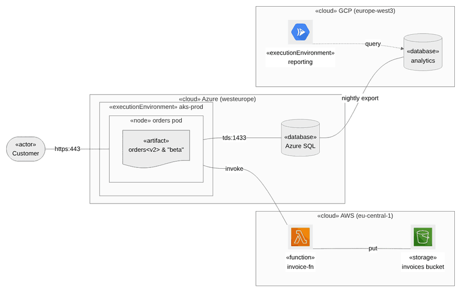 | 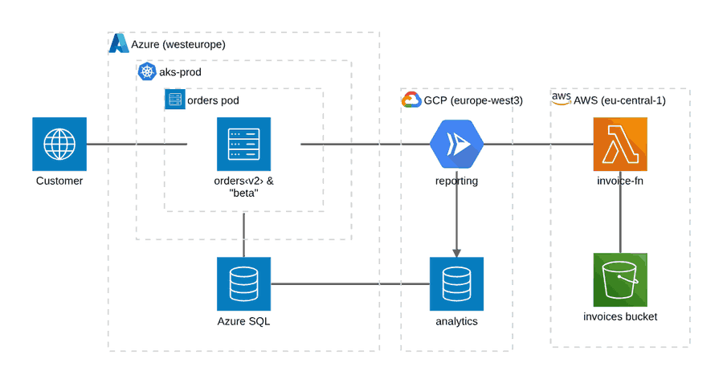 |
| **PlantUML** | **Own SVG + ELK.js** |
| 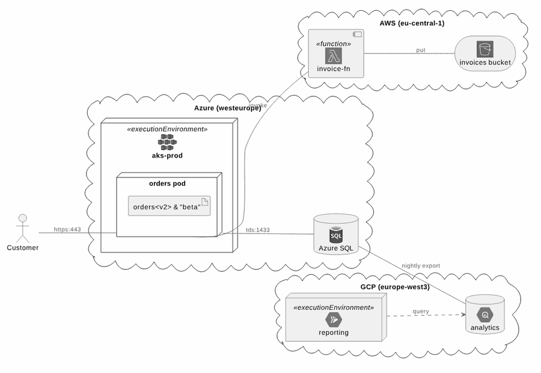 | 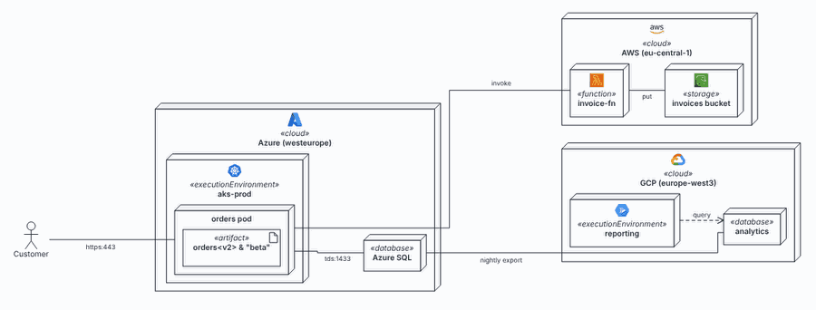 |

| Criterion | Mermaid flowchart | Mermaid architecture-beta | PlantUML | Own SVG + ELK.js |
|---|---|---|---|---|
| Node (3D box) | approximated: rectangle / subgraph with «stereotype» | missing: icon tile, no stereotype | correct | correct |
| ExecutionEnvironment, nesting | subgraph with «executionEnvironment» | group, no keyword | correct | correct |
| Artifact | approximated: `doc` shape + «artifact» | missing (service tile) | correct | correct (document icon) |
| CommunicationPath with label | correct | **label lost** (no edge label syntax) | correct | correct |
| Dependency (dashed, open arrow) | approximated: dotted, filled arrowhead | approximated: solid, filled arrowhead | correct | correct |
| Cloud icons | leaves only (`@{ icon: … }`), not on containers | on services and groups | stdlib sprites (monochrome), on any element | on any element, coloured |
| SVG → id | **18/18 by id** | 12 by id, 6 derived from endpoints | 12 by id (`data-qualified-name`), 6 by order | **18/18 by id** (`data-id`) |
| Warm re-render | 85 ms | 75 ms | 57 ms + 10 ms insert, + network | **23 ms** |
| Cold first render | 197 ms | 327 ms | 1041 ms (new JVM per call) | 151 ms (ELK warm-up) |
| SVG size | 96.9 KB | 36.1 KB | 27.2 KB | 24.3 KB |

`architecture-beta` is ruled out: edges cannot carry labels (protocol and port are core information
in Arcviz), there are no stereotypes, and services cannot contain anything, so every node with
children must become a group, which is not an edge endpoint of its own (edges attach to one of its
services with the `{group}` modifier).

### Activity diagram

| Mermaid flowchart (dagre) | Mermaid flowchart, `layout: swimlane` |
|---|---|
| 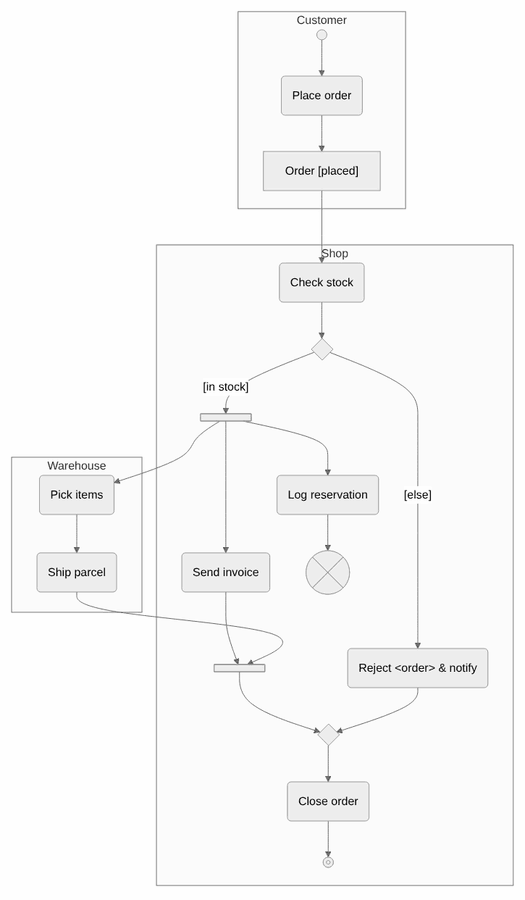 | 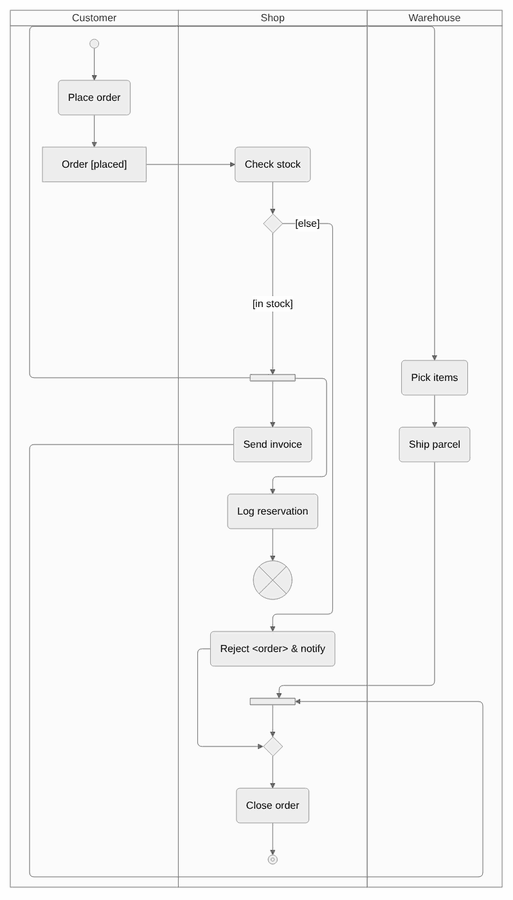 |
| **PlantUML** | **Own SVG + ELK.js** |
| 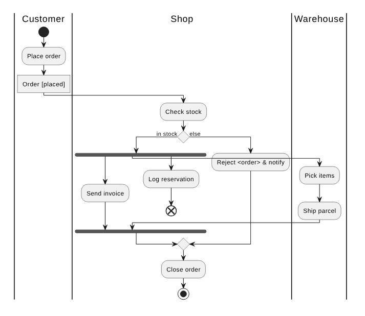 | 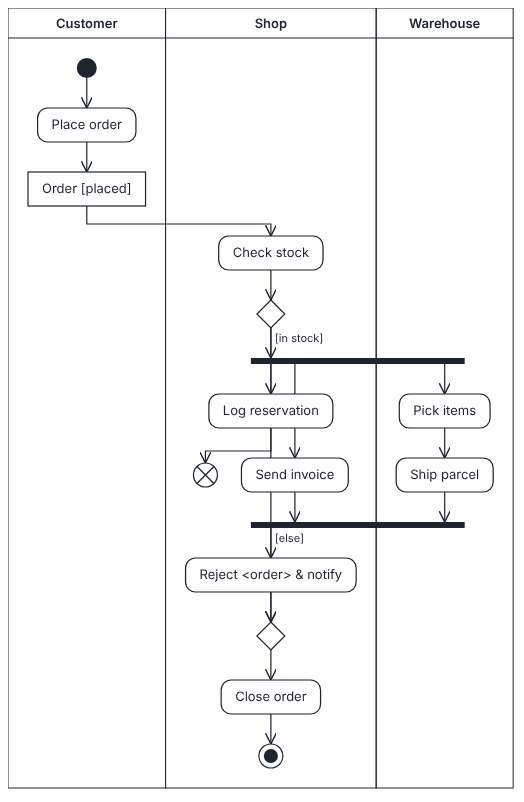 |

| Criterion | Mermaid (dagre) | Mermaid `swimlane` | PlantUML | Own SVG + ELK.js |
|---|---|---|---|---|
| Action, object node | correct (`rounded`, `rect`) | correct | correct (object via `<<object>>`) | correct |
| Initial, activity final, flow final | correct (`sm-circ`, `fr-circ`, `cross-circ`; flow final drawn oversized) | correct | correct | correct |
| Decision / merge with guards | correct (guards as edge labels) | correct | correct | correct |
| Fork / join | approximated: outlined bar (`fork` shape) | approximated | correct (filled bar) | correct (filled bar) |
| Partitions (swimlanes) | **wrong**: partitions become free-floating boxes | **correct lanes**; some flows take long detours around lanes | correct lanes; here a fork bar overlaps an action | correct lanes, but own placement and a naive router: flows can cross nodes |
| Input model | graph | graph | current syntax is **block-structured** (`if`/`fork` blocks); see below for `goto` and the legacy syntax | graph |
| SVG → id | **36/36 by id** | **36/36 by id** (lane ids are not prefixed with the render id) | **0/36** | **36/36 by id** |
| Warm re-render | 118 ms | 174 ms | 15 ms + 6 ms insert, + network | **20 ms** |
| Cold first render | 205 ms | 302 ms | 938 ms | 121 ms |
| SVG size | 61.9 KB | 55.3 KB | 10.6 KB | 7.1 KB |

Mermaid 11.17.2 (the vendored build) ships a `swimlane` layout for flowcharts, configured with
`layout: swimlane` in the diagram's front matter and typed in `MermaidConfig.swimlane`
(`lineHops`, `ignoreCrossLaneEdges`, `optimizeRanksByCrossings`, `automaticLaneOrdering`). Top-level
subgraphs become lanes. This is the only candidate besides PlantUML that draws real lanes without own
layout code. ELK.js has no notion of swimlanes: the prototype keeps ELK's layering, re-places nodes
per lane and routes the flows itself; a second ELK pass with interactive strategies, meant to let ELK
route around fixed lane positions, still moved nodes sideways by up to ~90 px and broke the lanes.
Production-quality lane routing would be own code.

PlantUML offers two ways out of its block structure, both checked with 1.2026.8. The experimental
`label`/`goto` of the current syntax rendered without error, but the jump edge was not drawn (the
branch ends in a dangling arrow). The legacy activity syntax (`(*) --> "A"`, `===bar===`) accepts
arbitrary graphs, including fork/join bars, but draws partitions as package-like boxes instead of
lanes and, like the current syntax, writes no ids for actions (only start and end nodes get
`data-qualified-name`). Neither changes the outcome for activity diagrams.

### Sequence diagram

| Mermaid `sequenceDiagram` | PlantUML | Own SVG (row layout) |
|---|---|---|
| 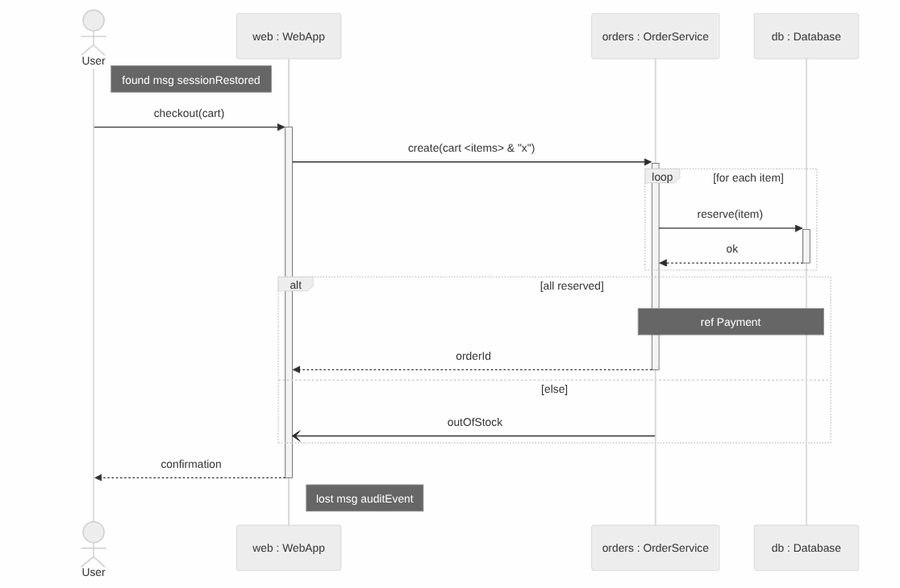 | 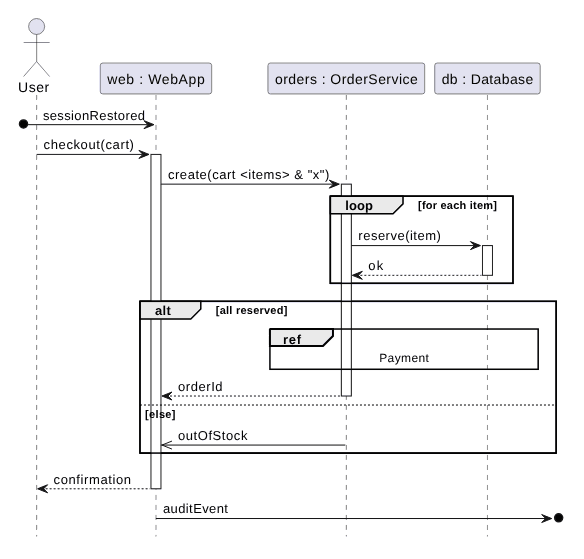 | 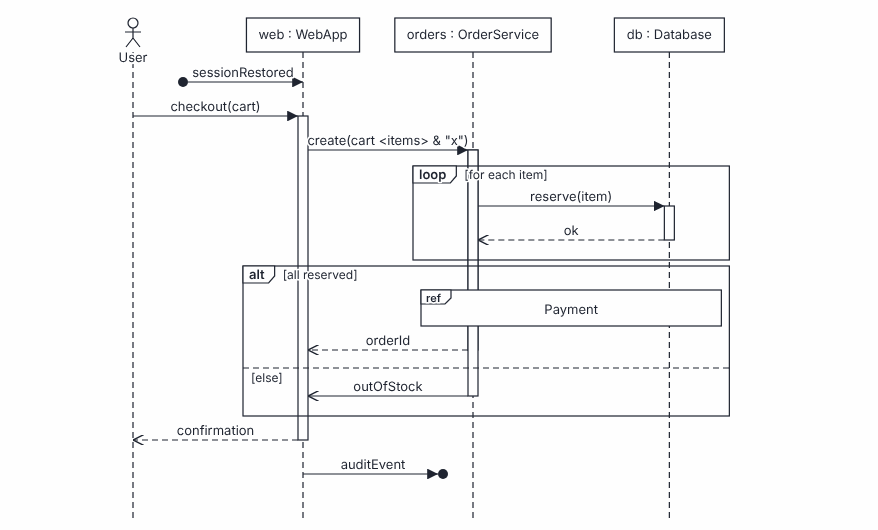 |

| Criterion | Mermaid | PlantUML | Own SVG |
|---|---|---|---|
| Lifelines, actor | correct (heads repeated at the bottom by default) | correct | correct |
| Synch / asynch / reply messages | correct | correct | correct |
| Activations (ExecutionSpecification) | approximated: tracked linearly, so the second `alt` operand cannot close the activation the first one closed (render error "Trying to inactivate an inactive participant"); one deactivation had to be dropped | correct | correct (operands restart from the state at the fragment start) |
| CombinedFragment `alt`/`loop` with guards | correct | correct | correct |
| `neg`, `assert`, `strict`, `seq`, `ignore`, `consider` | missing | missing (`group` workaround) | any operator (only a label; not tested beyond `alt`/`loop`) |
| InteractionUse (`ref`) | **missing** (drawn as a note) | correct | correct |
| Found / lost messages | **missing** (drawn as notes) | correct | correct |
| SVG → id | lifelines 4 by id; messages, fragments, notes 12 by order (`data-id="i<statement index>"`); operands 3 missing | **0/19** | **19/19 by id** |
| Warm re-render | 40 ms | 12 ms + 7 ms insert, + network | **1.6 ms** |
| Cold first render | 92 ms | 714 ms | 9 ms |
| SVG size | 29.8 KB | 8.7 KB | 5.7 KB |

The own sequence renderer needs no layout engine: lifelines are columns, every message, fragment
header, operand separator and interaction use is a row. The prototype is under 100 lines.

### Mapping SVG elements back to element ids

This criterion decides how much of the existing UI (click → inspector or drill-down, highlight of
changed elements, comparison marks, the review highlights planned in M12) works for a type.

| | Deployment | Activity | Sequence |
|---|---|---|---|
| Mermaid | 18/18 by id | 36/36 by id | 4 by id, 12 by order, 3 missing |
| PlantUML | 12 by id, 6 by order | 0/36 | 0/19 |
| Own SVG | 18/18 by id | 36/36 by id | 19/19 by id |

PlantUML writes `data-qualified-name`, `data-entity-1/2` and `data-source-line` only for
class-like diagrams (deployment). Activity and sequence SVGs contain no ids, classes or data
attributes at all. A workaround exists and was checked: a link `[[#<id>]]` on participants, messages
and actions wraps them in `<a href="#<id>">`, but the spike found no link syntax for decisions,
forks, fragments, operands and flows, and highlights would need the source regenerated with colours and a server round
trip. The own renderer emits one `<g data-id="…">` per model element, and highlights and marks are CSS
classes on it, without regenerating anything.

### Payload, size and live latency

| | Browser payload | Server | Warm re-render (deployment / activity / sequence) |
|---|---|---|---|
| Mermaid (already shipped) | `mermaid.min.js` 3.57 MB (0.98 MB gzip), script load ~450 ms | none | 85 / 118 (174 swimlane) / 40 ms |
| Own SVG | `elk.bundled.js` 1.61 MB (0.47 MB gzip) + renderer ~20 KB; script load ~150 ms. Sequence alone needs no ELK. | none | 23 / 20 / 1.6 ms |
| PlantUML | none | `plantuml-mit` jar 17.7 MB + Java runtime (the JDK on the test host is 286 MB); picoweb ~294 MB RSS after 180 renders with default heap | 57 / 15 / 12 ms + insert + network; 0.7–1.0 s per call without a long-running JVM |
| Icons | Iconify `logos` subset of the 7 icons used: 16 KB (full set 7.7 MB) | PlantUML stdlib is inside the jar | |

During an agent turn the UI re-renders after every tool call; all browser candidates stay well below
the time a tool round takes. The own renderer is 4–25× faster than Mermaid on the same diagram, which
matters only for large diagrams. PlantUML's warm numbers are good, but only with a long-running JVM:
a CLI call per render costs about one second.

### Cloud icons and licences

| Component | Licence | Notes |
|---|---|---|
| Mermaid 11.17.2 | MIT | already vendored |
| ELK.js (`elkjs` 0.12.0) | EPL-2.0 (or GPL-3.0-or-later) | dual-licensed, so it can be shipped under its GPL-3.0-or-later option, matching the project's GPL-3.0 licence; under EPL-2.0 it is weak copyleft per file (licence text and a source reference with the unmodified bundle). Not legal advice. |
| Iconify `logos` (`@iconify-json/logos`) | CC0-1.0 | AWS product icons (Lambda, S3, RDS, EKS, …), Kubernetes; for Azure and GCP only generic logos and a few products (Cloud Run, Cloud Functions). The logos are trademarks of their owners. |
| PlantUML `plantuml-mit` 1.2026.8 | MIT | the same release is also published under GPL, EPL, BSD and other licences; the MIT build rendered all three examples |
| PlantUML stdlib `azure`, `awslib14`, `gcp` | not verified | icons derived from the vendors' official sets; upstream licence files are on github.com, which the study environment could not reach (proxy 403) |
| Official AWS / Azure / Google Cloud architecture icons | vendor terms, not verified | published for use in architecture diagrams; whether they may be redistributed inside a software product (vendored into the wheel and Docker image) needs a legal check before #100 vendors them |

Icon support per candidate: Mermaid flowchart takes registered Iconify packs (`registerIconPacks`),
but only on leaf nodes. PlantUML can use its stdlib sprites anywhere in a label; they are monochrome
and the colour is a skin parameter. The own renderer can put any vendored SVG icon anywhere,
including on containers. Azure product icons are the gap for the browser candidates: the `logos`
pack has none (other Iconify sets were not checked).

### Security

The hostile-name test (`bench/hostile.mjs`) sends names like ``,
`</text><script>…`, a Mermaid `click` injection, PlantUML `%getenv(…)` / `%load_json(…)`, a newline
followed by `@enduml` / `!include`, and `[[javascript:…]]` through every candidate and checks that the
name is shown literally and that the SVG contains no script, event handler or link.

| | Result | What is needed |
|---|---|---|
| Mermaid (strict, entity-code escaping as in `escape_text`) | literal and clean for all names, except a name with a line break: shown with a break in a flowchart, a **parse error** in `sequenceDiagram` | normalise line breaks (open issue #103); `#` is not escaped (#102) |
| Own SVG | literal and clean for all names | XML-escape text and attributes; no parser in between, smallest surface |
| PlantUML, escaped (every non-alphanumeric character as `<U+XXXX>`) | literal and clean for all names | the escaping plus the SANDBOX profile |
| PlantUML, unescaped | `%getenv(…)` is **evaluated**, `[[…]]` becomes `<a>` elements, `@enduml` breaks the diagram, creole markup is interpreted | |

PlantUML's preprocessor runs on the whole text, labels included. With the profile `UNSECURE` an
`!include` reads local files and fetches URLs (checked: a local file was included, a URL was
requested, which is an SSRF), and `%getenv` leaks environment variables. The SANDBOX profile blocked
file and URL includes and returned empty values for `%getenv`, while stdlib includes (`<awslib14/…>`)
kept working. A runtime PlantUML service would also need request size limits, render timeouts and its
own container.

### Operations and effort

| | Operational cost | Integration effort (estimate) |
|---|---|---|
| Mermaid | none beyond today (static files) | deployment: done; icons (#100) 1–2 days; activity with swimlanes 2–3 days |
| Own SVG | none (static files); one more vendored artefact (ELK) only if used for deployment/activity, with its own pin in `scripts/vendor_mermaid.py` or a sibling script | sequence 4–6 days (in M13, #101); deployment with ELK 6–8 days (focus mode stubs, direction, marks, PNG/SVG export, dark theme); activity with ELK lanes 6–10 days, the lane router being the risk |
| PlantUML | a JVM service next to the app (container, health check, memory ~300 MB, scaling, timeouts), or a JRE inside the app image; Graphviz not needed (checked: all three examples render without a `dot` executable, deployment also with `!pragma layout smetana`; the measured run had Graphviz 2.42 installed) | 5–8 days plus operations, and the id mapping for activity and sequence would remain missing |

## Recommendation

| Diagram type | Renderer | Why |
|---|---|---|
| Deployment | **Mermaid flowchart** (as today), icons from a vendored Iconify subset (#100) | all ids map; focus mode, comparison, direction and exports exist and are tested; UML notation is approximated (no 3D node box, no icons on containers), which the own renderer would fix at 6–8 days and +0.47 MB gzip |
| Activity | **Mermaid flowchart with `layout: swimlane`** when the diagram has partitions, dagre otherwise | real lanes and all ids map with no new dependency; routing detours are the weak point and the reason to revisit |
| Sequence | **Own SVG renderer** (as decided in #101) | the only candidate that draws found/lost messages, interaction uses and arbitrary operators and maps every element (including operands) by id; tiny, fast, no layout engine |
| All types | **PlantUML for export only** (ADR-0018, #107) | best notation out of the box but no ids in activity/sequence SVGs, a JVM service, and a preprocessor that makes every label an injection surface |

Revisit (per type, behind the renderer interface from #98) when one of these becomes true:

- UML node notation or icons on containers are required for deployment diagrams → own SVG + ELK.js
  for deployment (prototype quality is already close, see the screenshot above).
- The swimlane layout's routing is not acceptable on real activity diagrams, or a Mermaid upgrade
  changes the id scheme the UI relies on → own SVG for activity, with an own lane router.
- ADR-0017's reason for not vendoring ELK (payload) is then re-weighed: `elkjs` alone is 1.61 MB
  (0.47 MB gzip), against 2.5 MB for Mermaid's `@mermaid-js/layout-elk` measured there.

## Findings outside the scope of this study

- Mermaid's swimlane layout gives lane clusters ids without the render prefix (`n_p_shop` instead of
  `m3-n_p_shop`); two renders in one document (canvas plus an off-screen export render) would carry
  duplicate ids. Harmless for the click mapping, which searches inside one SVG.
- Mermaid's `sequenceDiagram` numbers its statements (`data-id="i<n>"`); the numbers skip values,
  so other statements (activations, block starts and ends) appear to be counted too. A generator
  that wants to map messages back must reproduce that numbering or rely on document order.
- The vendored Mermaid already supports edge ids (`a e1@--> b`), which give edges a `data-id`;
  the comparison marks could use them instead of `linkStyle <index>`.

## Reproducing

See `spikes/renderers/README.md` on the spike branch. The measured run is stored in
`spikes/renderers/out/results.json` there, together with every generated source and SVG.
