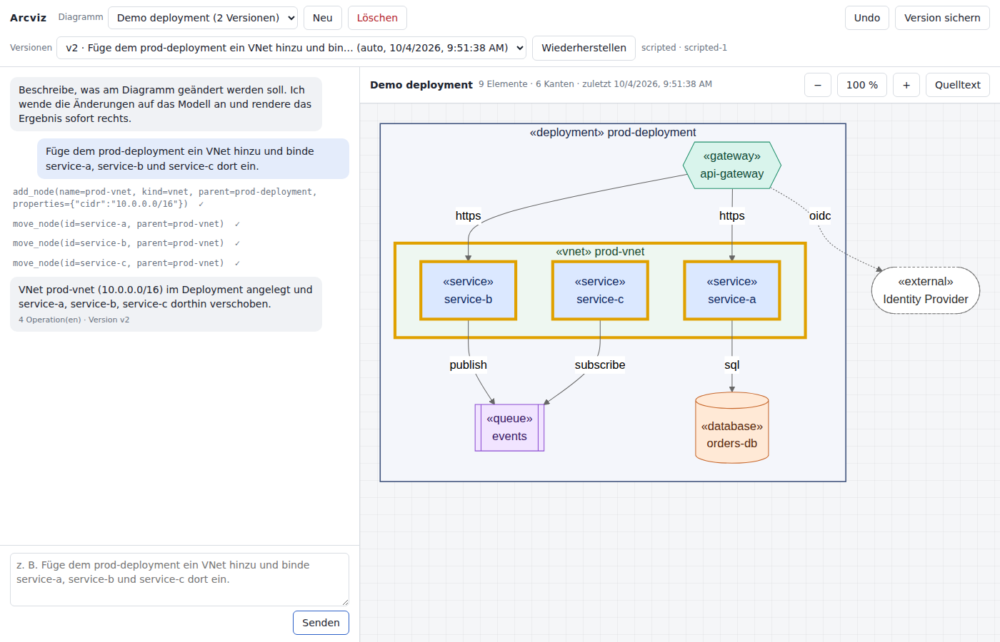

# User guide

The Arcviz UI has two halves: the **chat** on the left, where you give instructions and read what
the model did, and the **canvas** on the right, where the current diagram is rendered. Left of the
chat, the **project navigator** lists your own and shared projects, their sections and diagrams ([Projects and
sections](projects.md), [Own and shared projects](workspaces.md)). The header holds the diagram and version controls.

| Area | Controls |
|---|---|
| Header, left | **Projekte** (show or hide the navigator), **Neu** (create in the open project), **Löschen** (delete), **Importieren** |
| Navigator | **Projekt** selector (groups **Meine Projekte** and **Mit mir geteilt**) with **+** and **⋯** (share, rename, describe, export, import, delete), **+ Abschnitt**, the tree of sections and diagrams with a **⋯** menu per row |
| Header, right | **Undo**, **Version sichern** (manual snapshot), **Versionen** selector, **Wiederherstellen** (restore), **Chat leeren**, active provider and model, your name, **Hilfe** (**Rundgang starten**, and this documentation for the running version: user guide, architecture documentation, everything). The header always stays one row: a long version name is shortened with "…" (the tooltip shows it in full), and in a narrow window the less used tools move into the **⋯** menu |
| Chat | Transcript, input box, microphone button with **Dauerhören** and language selector, **Senden** |
| Canvas toolbar | Diagram title and statistics, **Review** (architecture review panel), **Richtung** (layout direction) |
| View row | Breadcrumb of the current focus, **Ansicht** (container to focus on), **↑ Ebene höher**, **Bearbeiten** (inspector for the focused container), preview banner, zoom **−** / **100 %** / **+** / **Einpassen**, **Quelltext** (Mermaid source), **Export** menu |

The bar between chat and canvas is a **splitter**: drag it to change the split, use the arrow keys
when it has focus (++shift++ for larger steps), double-click to reset. The position is remembered
in the browser. The UI follows the operating system's light or dark setting, including the
diagram colours, and the selector **Design** in the personal settings (user menu at the top right) switches between several looks of the interface
([Canvas: Design](canvas.md#design-skins)).
The interface and the assistants speak German or English, selectable in the personal settings ([Canvas: Language](canvas.md#language)).

!!! tip "Coding agents"
    Agents such as Claude Code can read the components, their responsibilities and relations and link components to code
    over MCP; they propose changes, you apply them: [Coding agents (MCP)](agents.md).

!!! tip "Documentation inside the app"
    **Hilfe** opens the documentation that ships with the running version in a new tab, also without
    network access: the app serves it under `/docs/`. In a development checkout it is only there
    after `make docs-bundle`; otherwise the page explains how to build it.

!!! note "Interface language"
    The UI labels are German; the documentation is English and names the labels as they appear
    on screen. The model replies in the language of your instruction.

The guide is split into:

- [Diagrams](diagrams.md): creating, switching and deleting diagrams; templates.
- [Chat](chat.md): how an instruction becomes a change, what the transcript shows, example instructions.
- [Elements and edges](elements.md): the kinds you can use and how they are drawn.
- [Versions](versions.md): automatic and manual snapshots, preview, restore and undo.
- [Canvas](canvas.md): pan and zoom, focus on a container, theme, UI designs, Mermaid source view and export.
- [Element inspector](inspector.md): edit name, kind, container, note, properties and edges directly.
- [Working together](collaboration.md): live updates from other people, editing the same element, who else is here.
- [Voice input](voice.md): dictate instructions with push-to-talk or continuous listening.
- [Architecture review](review.md): rule checks and an AI review of the diagram, findings highlighted on the canvas.

## Signing in

If the operator enabled the app's own authentication (`ARCVIZ_AUTH=token`), the first visit shows a
page **Anmelden** that asks for the access token (*Zugangstoken*). After signing in you are taken to
the page you wanted to open; the browser stays signed in for seven days. **Abmelden** in the user menu (top right)
ends the session. When the session has expired, the next action takes you back to the sign-in page.
Behind a company login (for example Entra ID in front of Azure Container Apps) you sign in there
instead, and Arcviz shows no page of its own.
