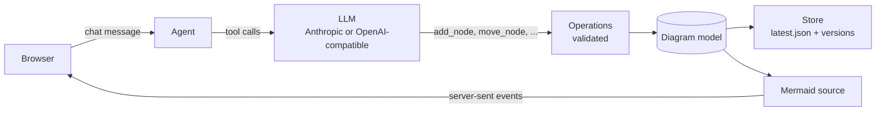

# Arcviz agent

Arcviz is a chat interface that edits a UML-style deployment model through a large language model
and renders the result live as a diagram. You describe a change in plain language; the model turns
it into a sequence of typed, validated operations; the diagram on the right updates after every
operation, and every chat turn becomes a version you can preview, restore or undo.

**Example.** On the demo diagram, type

> Füge dem Deployment ein VNet hinzu und verschiebe service-a, service-b und service-c dort hinein.

The model creates the vnet inside the deployment, moves the three existing services, keeps every
edge intact and confirms what changed.

## How it works

- The **model** is a tree of elements (containers such as deployment, vnet or subnet can hold other
  elements) plus typed edges between elements.
- **Operations** are the only way to change a diagram. Each one validates its input (unknown ids,
  containment cycles, leaf kinds that cannot hold children) and leaves the model untouched on error.
  The LLM tools and the REST API share the same operations.
- The **LLM layer** is provider-neutral: Anthropic Claude via the official SDK, or any
  OpenAI-compatible endpoint (OpenAI, Ollama, vLLM, LM Studio and others).
- **Persistence** is a directory of JSON files per diagram: the current state, immutable version
  snapshots and the chat transcript.
- **Rendering** generates Mermaid flowchart source on the server and renders it in the browser.

## Where to go next

- [Quick setup](getting-started/quick-setup.md): run Arcviz locally or in Docker in a few minutes.
- [User guide](guide/index.md): diagrams, chat, element kinds, versions and the canvas.
- [Configuration](reference/configuration.md) and [HTTP API](reference/api.md) references.
- [Technical specification](spec/index.md): how Arcviz is built, for contributors and the coding agent.
- [Troubleshooting](getting-started/troubleshooting.md): common problems and their fixes.
