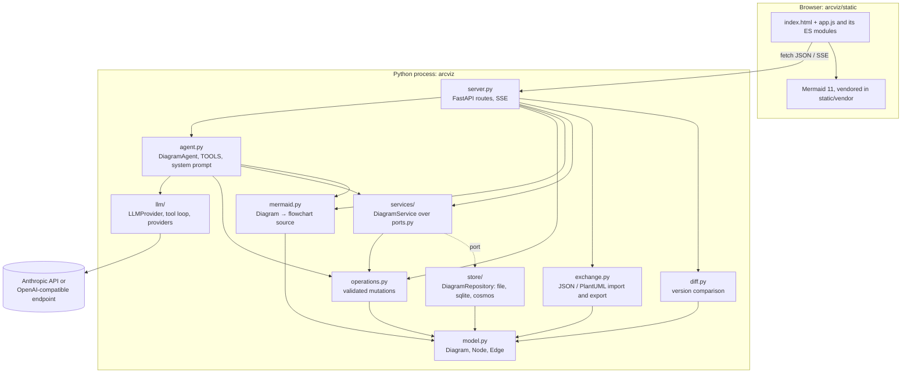

# Technical specification

This section describes Arcviz as it is implemented. It is the reference for contributors and for
the coding agent; every page names the source files it covers so claims can be checked. The design
of upcoming or recent changes and the decisions behind them live in [Architecture](../architecture/index.md).

!!! warning "Keep it current"
    Any change to the model, operations, HTTP API, LLM layer, persistence, rendering,
    configuration, CI or release process must update the matching page here **in the same pull
    request**. The rule is stated in `CLAUDE.md` for the coding agent and in `CONTRIBUTING.md` for
    people. The docs build in CI only checks that pages build; the content check is the review.

## System overview

Arcviz is a single Python process (FastAPI on uvicorn) that serves a static browser UI and a JSON
API, calls an LLM through a provider abstraction, and stores state as JSON files.

## Request flow of a chat turn

1. `POST /api/diagrams/{id}/chat` validates the body, lazily creates the provider and the
   `DiagramAgent`, and streams `DiagramAgent.chat()` as server-sent events from a thread pool.
2. The agent loads the diagram, builds the system prompt with the full model summary, loads the
   last 30 transcript turns and starts `LLMProvider.run_turn()`.
3. The shared loop calls the provider, executes each tool call through `operations.apply()`,
   persists `latest.json` after each success, and feeds results back until the model stops
   or the round limit is hit.
4. Every event is forwarded to the browser; successful `tool_result` events carry the intermediate
   model and Mermaid source so the diagram updates live.
5. In a `finally` block the agent writes an automatic version (if the model changed) and the
   transcript entry, then emits the `final` event.

## Source map

| Path | Responsibility | Spec page |
|---|---|---|
| `arcviz/model.py` | Domain model, kinds (built-in and the active catalogue), ids, integrity, textual summary | [Domain model](domain-model.md) |
| `arcviz/kinds.py` | Loading and validating the kinds file (`ARCVIZ_KINDS_FILE`) | [Domain model: kinds file](domain-model.md#kinds-file) |
| `arcviz/operations.py` | The only mutation path; validation; dispatcher | [Operations](operations.md) |
| `arcviz/llm/` | Provider abstraction, tool loop, Anthropic and OpenAI providers, factory | [LLM layer](llm-layer.md) |
| `arcviz/agent.py` | Tool definitions, system prompt, chat turn orchestration, persistence of a turn | [Agent](agent.md) |
| `arcviz/prompts/` | System prompt texts (shared blocks, expert part per diagram type) and their composition | [Agent: system prompt](agent.md#system-prompt) |
| `arcviz/ports.py`, `arcviz/services/` | Persistence ports (protocol, value types, errors) and the application services every entry point calls | [Persistence: application services](persistence.md#application-services) |
| `arcviz/projects.py` | Projects: section tree, ordered diagram membership, project operations, the shared model's elements | [Projects](projects.md) |
| `arcviz/project_model.py`, `arcviz/services/model.py` | Shared project model: element kinds, which view elements may stand for them, `ModelService` (links, rename propagation, sync) | [Projects: shared model](projects.md#shared-model) |
| `arcviz/requirement_model.py`, `arcviz/services/requirements.py` | Requirements: raw wording and refinement, suggestions, links to drivers, scenarios and decisions, coverage, `RequirementService` | [Requirements](requirements.md) |
| `arcviz/agent_model.py` | Element tools of the diagram chat and the project chat | [Agent: shared project model](agent.md#shared-project-model) |
| `arcviz/store/` | `DiagramRepository` (versioning semantics, undo/redo targets, transcript) and the `file`, `sqlite`, `cosmos` backends, factory, migration | [Persistence](persistence.md) |
| `arcviz/gitmirror.py` | Optional Git mirror of every version (commit per snapshot, optional push) | [Persistence](persistence.md#git-mirror) |
| `arcviz/mermaid.py` | Diagram to Mermaid flowchart | [Rendering](rendering.md) |
| `arcviz/diff.py` | Version comparison: diff of two states and the merged, marked render input | [Rendering](rendering.md#comparison-marks) |
| `arcviz/exchange.py` | Whole-diagram JSON document (export, validated import) and PlantUML export | [Import and export](exchange.md) |
| `arcviz/rules.py` | Deterministic architecture checks per diagram type, `Finding` schema | [Architecture review](review.md) |
| `arcviz/review.py` | LLM architecture review: prompt, `submit_review` tool, validation | [Architecture review](review.md#llm-review) |
| `arcviz/cli.py` | `arcviz-migrate` (copy between stores, project repair) | [Persistence: migration](persistence.md#migration) |
| `arcviz/server.py` | FastAPI app, routes, SSE, static files, `main()` | [HTTP server](http-server.md) |
| `arcviz/templates.py` | Starter diagrams (`empty`, `demo`, `hub-spoke`, `aks-database`, `event-driven`) | [Domain model](domain-model.md#templates) |
| `arcviz/static/` | Browser UI: entry point `app.js` and native ES modules per feature, pure logic in Node-tested modules | [Frontend](frontend.md) |
| `tests/`, `.github/`, `Dockerfile`, `release-please-config.json`, `zensical.toml` | Quality gates, CI, releases, docs | [Build, CI and release](build-and-release.md) |

## Design decisions

- **Typed operations instead of free-form edits.** The model never writes the model file or
  diagram source. It calls tools with JSON arguments; each tool is a validated operation that
  either applies fully or not at all. This keeps the model consistent by construction and makes
  the REST API and the LLM share one code path.
- **Live apply with versions by default, propose-then-confirm on request.** Changes are applied as
  the model makes them, so the user watches the diagram evolve; safety comes from automatic versions
  per turn, undo and restore. An optional propose mode (**Vorschau**) runs a turn as a dry run and
  applies it only after confirmation ([ADR-0015](../architecture/adr/0015-client-held-proposals.md)).
- **Provider-neutral LLM layer.** The agentic loop lives in one place; a provider only translates
  message formats. Anthropic is the default; OpenAI-compatible servers make local models possible.
- **Pluggable persistence, files by default.** The store is an abstract repository
  (`DiagramRepository`) with the versioning semantics implemented once and interchangeable backends:
  JSON files (default, human-readable, single instance), SQLite (single host) and Azure Cosmos DB
  (several replicas). Versions are immutable snapshots, not diffs ([ADR-0003](../architecture/adr/0003-snapshots-not-diffs.md)).
  An optional Git mirror (`ARCVIZ_GIT_DIR`) commits every version with the instruction as subject, as
  a second record for diffs and sharing; it is never the source Arcviz reads from.
- **Server-side Mermaid generation.** The server owns the mapping from model to picture so the
  browser stays thin and the source can be reused elsewhere.
- **Python-only runtime.** No Node build step; the UI is plain ES modules served as static files.
  Mermaid is vendored as a pinned single-file build (`scripts/vendor_mermaid.py`), so the app
  works offline and the wheel and the image are self-contained.

## Non-goals and known constraints

- No users or multi-tenancy: authentication is optional (a shared token or a trusted proxy header,
  off by default), and every authenticated client may do everything.
- The `file` and `sqlite` backends are single-host: one process per data directory. Concurrent
  requests on one diagram never lose updates (conditional writes on a revision); scale-out needs the
  `cosmos` backend.
- The model summary in the system prompt is capped (`ARCVIZ_CONTEXT_BUDGET`); beyond it the
  largest containers are collapsed and the model has to fetch details with `get_diagram`, which
  costs extra tool rounds on very large diagrams.
